# Özgür Tokay

> Software Engineer focused on scalable Java backends and modern web/mobile products.

---

## About Me

  

## Core Stack

  

## Engineering Focus

  

## Toolbox

---

## GitHub Analytics

  
  
  
  

---

## Projects

  
  
  
  

### Enterprise Contributions

| Project | Focus | Stack |
| --- | --- | --- |
| [E-Invoice Integration System](https://otokay.com/en/project/e-invoice-integration) | Invoice integration compliant with GIB formats | Java, MsSQL, JSF, PrimeFaces, Groovy, Jenkins |
| [E-Ledger Integration System](https://otokay.com/en/project/e-ledger-integration) | E-ledger creation and management for clients | Java, MsSQL, Java FX, Java EE, Jenkins |
| [E-Reconciliation System](https://otokay.com/en/project/e-reconciliation-system) | Automated reconciliation of financial statements | Java, MongoDB, JSF, PrimeFaces, Bootstrap |
| [Customer Support Platform](https://otokay.com/en/project/customer-support-platform) | Recording and resolving customer-reported errors | Java, MongoDB, JSF, PrimeFaces, Bootstrap |
| [E-Reconciliation Robot](https://otokay.com/en/project/e-reconciliation-robot) | BERT-based document comparison and analysis | Python, TensorFlow, PyTorch, NumPy, Pandas |

Explore more work and ongoing experiments on [my repositories page](https://github.com/tokayOzgur?tab=repositories) and in the [case studies on otokay.com](https://otokay.com/en).

Open to collaboration on backend-heavy products, full-stack apps, and mobile experiences.
